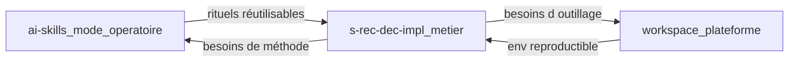

# Usage de l’IA agentique — synthèse

**En date du :** 22 juillet 2026  
**Période couverte :** mi-juin 2026 → 22 juillet 2026

## 1. Contexte

Ce dossier documente **comment l’IA agentique (Cursor Agents) est déjà utilisée** sur trois espaces de travail complémentaires. L’objectif n’est pas d’auditer une personne, ni de lister chaque session : c’est d’extraire un **modèle de pratique** reproductible.

**Sources** : transcripts agent locaux agrégés, anonymisés au niveau « interne CAFAT » (noms de projets et domaines métier OK ; pas de secrets, pas de dumps runtime, pas de chemins machine personnels).

## 2. Idée centrale

L’IA agentique est **déjà utile** sur du legacy Java métier et sur l’outillage développeur.

Le gain durable ne vient pas du chat improvisé. Il vient d’un **mode opératoire** :

- skills versionnés (rituels répétables) ;
- glossaire et docs de domaine ;
- séparation claire entre *produit métier*, *méta (skills)* et *plateforme (workspace)*.

Autrement dit : *Investir dans la **méthode** autant que dans l’outil.*

## 3. Stats (échantillon des 3 workspaces)

| Workspace                             | Rôle                                   | Sessions agent (approx.) | Période            |
| ------------------------------------- | -------------------------------------- | ------------------------ | ------------------ |
| `[s-rec-dec-impl](s-rec-dec-impl.md)` | Produit métier legacy (DEC)            | **~180**                 | 17/06 → 22/07/2026 |
| `[workspace](workspace.md)`           | Plateforme / scripts / serveurs locaux | **~25**                  | 16/06 → 21/07/2026 |
| `[ai-skills](ai-skills.md)`           | Catalogue de skills / mode opératoire  | **~8**                   | 25/06 → 15/07/2026 |
| **Total échantillon**                 |                                        | **~213**                 | ~5 semaines        |

Répartition approximative des types d’activité **sur l’ensemble** (arrondie ; une session = un fil agent) :

| Type                                       | Part approx. |
| ------------------------------------------ | ------------ |
| Développement / exploration divers         | ~25 %        |
| Conception / domaine métier (+ SQL/schéma) | ~20 %        |
| Diagnostic / debug runtime                 | ~15 %        |
| Hygiène Git / commits                      | ~15 %        |
| Documentation / handoffs                   | ~10 %        |
| Skills / mode opératoire                   | ~10 %        |
| Infra / outillage workspace                | ~5 %         |

Lecture : le volume est **dominé par le dépôt métier**, ce qui est attendu. 

Les workspaces « skills » et « plateforme » sont petits en sessions mais **structurants** : ils conditionnent la qualité des 180 sessions produit.

> **Hors périmètre de cet échantillon :** d’autres dépôts de la famille `s-rec-`* / `e-rec-*` ont aussi des transcripts agent. Ils ne sont pas détaillés ici ; le modèle ci-dessous reste applicable.

## 4. Trois rôles d’espace de travail

| Espace     | Question à laquelle il répond                       | Fichier                                |
| ---------- | --------------------------------------------------- | -------------------------------------- |
| Métier     | Comment livrer / corriger le logiciel ?             | [s-rec-dec-impl.md](s-rec-dec-impl.md) |
| Méta       | Comment travailler *avec* l’agent de façon stable ? | [ai-skills.md](ai-skills.md)           |
| Plateforme | Sur quel terrain l’équipe développe ?               | [workspace.md](workspace.md)           |

Une généralisation CAFAT qui ne couvrirait que le chat dans le dépôt applicatif **manquerait** la moitié du levier.

## 5. Principes généralisables

1. **Contextualiser le domaine** — glossaire et docs avant les gros changements ; l’agent amplifie la clarté comme le flou.
2. **Externaliser les rituels en skills** — commit, challenge de conception, styles de dialogue : versionner ce qui se répète.
3. **Documenter les décisions et les handoffs** — chaque session doit pouvoir transmettre ; sinon le coût se paie au redémarrage.
4. **Humain sur le « quoi », agent sur le « comment »** — l’intention, l’arbitrage métier et la validation restent humains.
5. **Séparer outillage et code produit** — plateforme et skills hors des repos métier pour réutilisation multi-équipes.

## 6. Limites de cette synthèse

- Échantillon volontairement limité à **trois** workspaces.  
- Les volumes sont un **proxy d’activité**, pas un ROI monétaire ni une mesure de qualité livrée.  
- Classification thématique **approximative** (dérivée des échanges, pas d’une télémetrie cloud).  
- Pas de comparaison inter-équipes ni de benchmark fournisseur.

## 7. Note méthode

Données issues des transcripts agent stockés localement par Cursor pour chaque dossier racine ouvert. Agrégation manuelle / semi-automatique, rédaction snapshot au 22 juillet 2026. Aucune donnée d’identification personnelle ni secret d’infrastructure n’est reproduit dans ces pages.