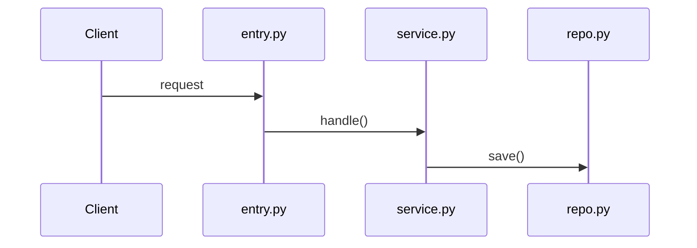

# context/rg/ Doc Format

One doc per unit (file, module, or feature). Named for the unit: `auth-flow.md`, `billing-cron.md`.

## Structure

```md
# {Unit name}

{One or two sentences: what this unit is for and why it exists.}

## Key flows

- **{Flow name}**: {what happens, in order} — `entry.py:12` → `service.py:40` → `repo.py:88`



## Dependencies

- **In**: who calls this unit and why
- **Out**: what this unit calls and why

## Gotchas

- {Surprises, footguns, deliberate deviations — each cited to code}

## Open assumptions

- {Unproven claims awaiting user confirmation. Empty section = fully verified.}
```

## Rules

- **Cite everything.** Every flow step and gotcha points to `file:line` or a call path. No citation → it belongs under *Open assumptions*, not here.
- **Draw the flow.** Add a mermaid chart (sequence, flowchart, state, ER — whatever fits) whenever a flow, state machine, or dependency graph is easier seen than read. A diagram is a claim too: its nodes and edges must trace to cited code.
- **Extract, don't narrate.** Capture intent and consequence, not a line-by-line paraphrase of the code.
- **Domain terms go to `CONTEXT.md`.** Define a term once, in the glossary; reference it here.
- **Empty sections are signal.** An empty *Open assumptions* means verified; an empty *Gotchas* means nothing surprising. Keep the headings.
